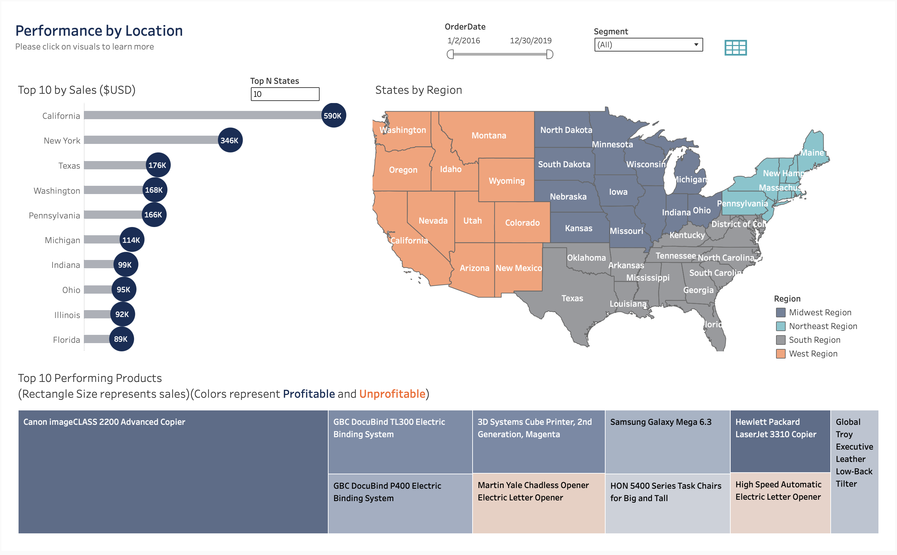
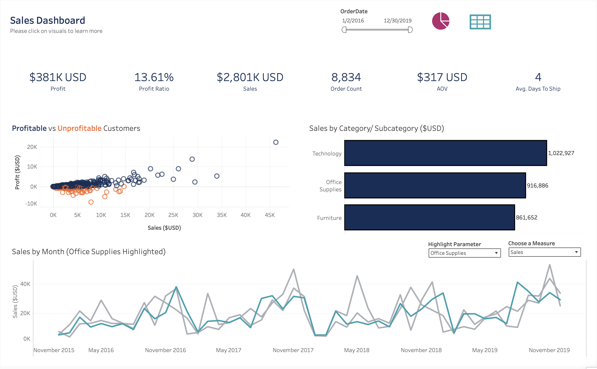
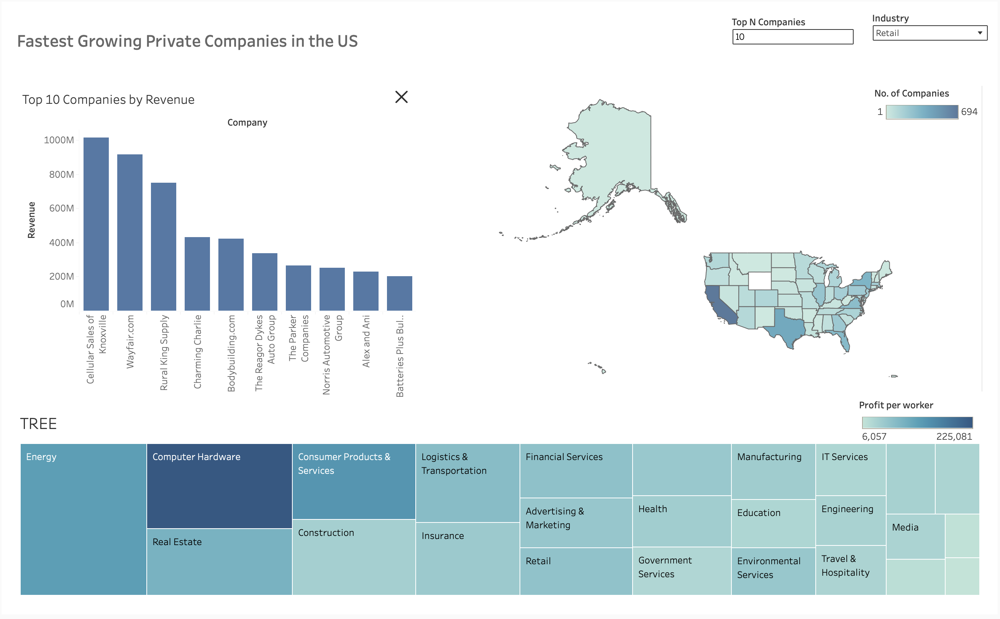
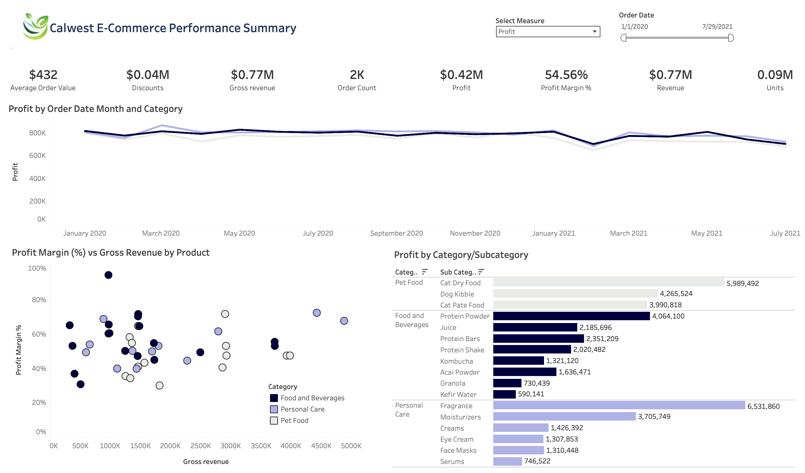
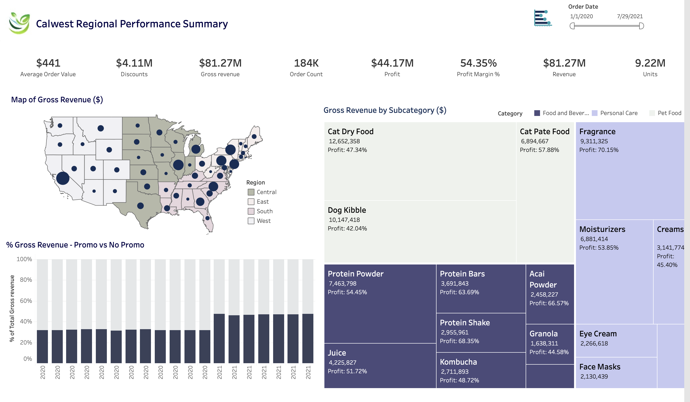

# Tableau Business Intelligence & Data Analytics Projects

Five interactive Tableau dashboards developed as part of the **Business Intelligence & Data Analyst (BIDA) Certification**, covering e-commerce, retail, market intelligence and sales analytics. Projects apply Tableau's data modelling, calculated fields, LOD expressions, parameters, advanced filtering and interactive dashboard design.

**Tableau Public:** [Muhammad Abdullah](https://public.tableau.com/app/profile/muhammad.abdullah7552)

---

### 1. Performance by Location (Superstore Retail)

**[View Interactive Dashboard on Tableau Public](https://public.tableau.com/app/profile/muhammad.abdullah7552/viz/PerformancebyLocationDashboard_17863871580720/Dashboard2)**

[](https://public.tableau.com/app/profile/muhammad.abdullah7552/viz/PerformancebyLocationDashboard_17863871580720/Dashboard2)

**Overview**

A regional retail performance dashboard analyzing geographic sales distribution, state-level performance and product profitability.

**Key Features:**
- **Top-N Lollipop Chart:** Dual-axis synchronized bar-and-circle visualization ranking the ten highest-performing states by sales, with data labels displayed at the circular endpoints.
- **Conditional Formatting and Profitability Analysis:** Treemap comparing the top ten products by sales, using rectangle size to represent sales and color to distinguish profitable products (steel blue) from unprofitable products (muted coral/orange).
- **Product-Level Profitability:** Highlights high-revenue products generating negative profits, including the GBC DocuBind P400 Electric Binding System and HON 5400 Series Task Chairs for Big and Tall.
- **Geographic Analysis:** US state map using categorical color encoding to distinguish the four regions (Midwest, Northeast, South and West), with direct state labels and interactive click-to-filter functionality.
- **Interactive Filtering:** Continuous Order Date range filter, Segment multi-select dropdown and cross-sheet navigation for exploring performance across different periods and customer segments.

---

### 2. Sales Dashboard (Executive Overview)

**[View Interactive Dashboard on Tableau Public](https://public.tableau.com/app/profile/muhammad.abdullah7552/viz/SalesandPerformanceDashboard_17863866022850/Dashboard1)**

[](https://public.tableau.com/app/profile/muhammad.abdullah7552/viz/SalesandPerformanceDashboard_17863866022850/Dashboard1)

**Overview**

An executive dashboard combining sales performance, customer profitability and monthly trends through interactive parameter selection, conditional formatting and multi-view navigation.

**Key Features:**
- **Executive KPI Cards:** Six business performance indicators covering profit ($381K), profit ratio (13.61%), sales ($2,801K), order count (8,834), Average Order Value ($317) and average days to ship (4).
- **Customer Profitability Analysis:** Scatter plot comparing customer-level sales and profit, using a calculated field to classify customers as profitable or unprofitable based on whether aggregated profit is positive or negative. A zero-profit reference line highlights the break-even threshold.
- **Parameter-Driven Measure Selection:** `Choose a Measure` parameter dynamically changes the metric displayed in the monthly sales trend.
- **Dynamic Category Highlighting:** `Highlight Parameter` allows users to select a product category, such as Office Supplies. A Boolean calculated field highlights the selected category in teal while displaying other categories in light grey.
- **Time-Series Analysis:** Monthly sales trend covering November 2015 to November 2019, allowing comparisons across product categories while preserving the overall trend.
- **Category and Subcategory Analysis:** Sales by category and subcategory displayed through labeled bar charts with custom borders and value labels.
- **Dashboard Navigation:** Custom navigation icons provide direct access to the Location and Product dashboard views.

---
### 3. Fastest Growing Private Companies in the US

**[View Interactive Dashboard on Tableau Public](https://public.tableau.com/app/profile/muhammad.abdullah7552/viz/PrivateCompaniesUS/Dashboard1)**

[](https://public.tableau.com/app/profile/muhammad.abdullah7552/viz/PrivateCompaniesUS/Dashboard1)

**Overview**

An interactive market intelligence dashboard examining revenue concentration, geographic distribution and workforce efficiency across high-growth private companies in the United States.

**Key Features:**
- **Dynamic Top-N Analysis:** Integer parameter allows users to select the number of leading companies by revenue. Combined with an Industry Context Filter, this ensures that Top-N rankings are calculated within the selected industry.
- **Context Filtering and Order of Operations:** Uses context filters to ensure industry selections are evaluated before Top-N ranking, allowing accurate comparisons within specific sectors.
- **Geographic Choropleth Map:** Maps company distribution across all 50 US states, including Alaska and Hawaii, using a sequential blue color scale to represent company counts.
- **Industry Treemap:** Compares industry sectors through rectangle size, representing aggregate revenue and company count, and diverging color intensity, representing profit per worker.
- **Interactive Filtering and Reset:** Click-to-filter actions connect the map, treemap and bar chart, while a reset button clears selected filters and restores the default dashboard view.
---

### 4. Calwest E-Commerce Performance Summary

**[View Interactive Dashboard on Tableau Public](https://public.tableau.com/app/profile/muhammad.abdullah7552/viz/CalwestE-CommercePerformanceSummary_17864809409940/Dashboard1)**

[](https://public.tableau.com/app/profile/muhammad.abdullah7552/viz/CalwestE-CommercePerformanceSummary_17864809409940/Dashboard1)

**Overview**

An executive-level dashboard analyzing e-commerce revenue, profitability, order activity and product-level performance across categories and subcategories.

**Key Features:**
- **Executive KPI Cards:** Eight key metrics covering Average Order Value (AOV), discounts, gross revenue, order count, profit, profit margin, revenue and units sold, with customized number formatting and percentage scaling.
- **Parameter-Driven Measure Selection:** A `Select Measure` parameter linked to a calculated field dynamically switches the metric displayed in the primary trendline and category breakdowns.
- **Time-Series Analysis:** Multi-line chart tracking monthly profit by product category from January 2020 to July 2021, supported by a continuous Order Date range slider.
- **Profitability and Revenue Analysis:** Scatter plot comparing profit margin against gross revenue by product, using shape and color to distinguish product categories and identify high-revenue, low-margin products.
- **Hierarchical Category Analysis:** Descending bar chart organizing product subcategories under parent categories, including Pet Food, Food and Beverages, and Personal Care, with color-coded category groupings.

---

### 5. Calwest Regional Performance Summary

**[View Interactive Dashboard on Tableau Public](https://public.tableau.com/app/profile/muhammad.abdullah7552/viz/CalwestRegionalPerformanceSummary_17864801314860/Dashboard2)**

[](https://public.tableau.com/app/profile/muhammad.abdullah7552/viz/CalwestRegionalPerformanceSummary_17864801314860/Dashboard2)

**Overview**

A geographic and promotional performance dashboard examining regional sales distribution, product-level revenue and the contribution of promotional campaigns to overall sales.

**Key Features:**
- **Dual-Layer Geographic Map:** Combines a filled map distinguishing the four US regions (Central, East, South and West) with a proportional symbol overlay sized by state-level gross revenue.
- **Promotional Mix Analysis:** 100% stacked bar chart comparing the percentage of gross revenue generated with and without promotions across monthly intervals from 2020 to 2021, using a Percent of Total table calculation computed along Table (Down).
- **Product Treemap:** Visualizes gross revenue by product subcategory, using rectangle size to represent revenue, color to distinguish product categories and embedded labels to display profit margins.
- **Cross-Dashboard Navigation:** Custom navigation icon allows users to move between the E-Commerce and Regional Performance dashboards.

---

## Tableau Technical Skills & Methods

The five projects apply a range of Tableau capabilities across data modelling, calculation development, filtering, visualization and dashboard interactivity.

### 1. Data Modelling & Data Integration

- **Logical Layer Relationships:** Used Tableau relationships to connect fact and dimension tables while preserving their individual levels of detail and reducing unintended duplication during analysis.
- **Physical Layer Joins:** Applied Inner and Left Joins to combine tables at the row level where required.
- **Data Blending:** Combined data from separate data sources where cross-source analysis was required, using linking fields to align records at the appropriate level of detail.

### 2. Calculated Fields & Level of Detail Expressions

- **Calculated Fields:** Developed custom calculations using Tableau's calculation language to create analytical measures, profitability classifications, conditional highlighting and dynamic metrics.
- **FIXED LOD Expressions:** Used `FIXED` expressions to calculate metrics at specified dimensions independently of the dimensions displayed in the visualization, subject to Tableau's filtering order.
- **INCLUDE LOD Expressions:** Used `INCLUDE` expressions to incorporate additional dimensions into calculations when the view required more granular analysis.
- **EXCLUDE LOD Expressions:** Used `EXCLUDE` expressions to remove dimensions from the view's level of detail when calculating broader aggregate metrics.
- **Analytical Applications:** Applied LOD calculations to customer-level profitability, cohort metrics and percentage-of-total benchmarks.

### 3. Tableau Order of Operations & Filtering

Applied Tableau's Order of Operations to control how filters interact with aggregations, rankings and calculated fields.

- **Context Filters:** Established filtering hierarchies by applying context filters before Top-N sets and FIXED LOD calculations. This enabled rankings to be evaluated within selected industries rather than across the entire dataset.
- **Dimension & Measure Filters:** Used dimension and measure filters to control the records and aggregated values displayed in visualizations.
- **Table Calculation Filters:** Applied table calculation filters, including `LOOKUP` and `INDEX`, to hide selected marks without changing the underlying window calculations, running totals or percentage-of-total results.
- **Interactive Filtering:** Combined filters and parameter selections to enable dynamic segmentation and comparison across dashboard views.

### 4. Parameters & Dynamic Calculations

- **String and Integer Parameters:** Created user-controlled parameters for selecting analytical measures, highlighting categories and defining Top-N rankings.
- **Dynamic Measure Swapping:** Paired parameters with calculated fields and `CASE` statements to switch between measures within the same visualization.
- **Top-N Filtering:** Used parameter-driven rankings to dynamically display the highest-performing companies or other selected entities.
- **Conditional Series Highlighting:** Combined parameter selections with Boolean calculated fields to emphasize selected categories while retaining the context of other data series.

### 5. Table Calculations & Analytical Functions

- **Percent of Total:** Applied table calculations to measure category and promotional contributions relative to overall totals.
- **LOOKUP:** Used table calculations to reference values from other positions within a partition.
- **INDEX:** Used positional indexing to identify and control marks within a visualization.
- **Running and Window Calculations:** Applied table calculation logic to support cumulative and window-based analysis while managing the dimensions across which calculations are computed.

### 6. Dashboard Design & Interactivity

- **Filter Actions:** Enabled click-to-filter functionality across worksheets, allowing selections in one visualization to update related dashboard views.
- **Highlight Actions:** Used visual highlighting to emphasize selected data points and categories without removing the remaining marks.
- **Navigation Buttons:** Created custom navigation controls to move between related dashboards and analytical views.
- **Dynamic Sheet Swapping:** Used parameter-driven sheet selection to switch between different visualizations within a dashboard.
- **Interactive Slicers and Filters:** Incorporated date-range filters, categorical dropdowns and multi-select controls for user-driven analysis.
- **Dashboard Layout & Formatting:** Applied consistent visual hierarchies, KPI cards, custom labels, color encoding and formatting to improve readability and analytical usability.

---

## Repository Structure

```text
my-tableau-projects/
│
├── README.md
│
└── tableau-projects/
    ├── calwest-ecommerce-performance.png
    ├── calwest-regional-performance.png
    ├── private-companies-US.png
    ├── performance-location.png
    └── sales-dashboard.png
```

## Project Availability

All five dashboards are published on Tableau Public and can be accessed through the interactive links provided above. The screenshots included in this repository provide a visual reference, while the Tableau Public links allow visitors to explore the dashboards and their interactive features.
